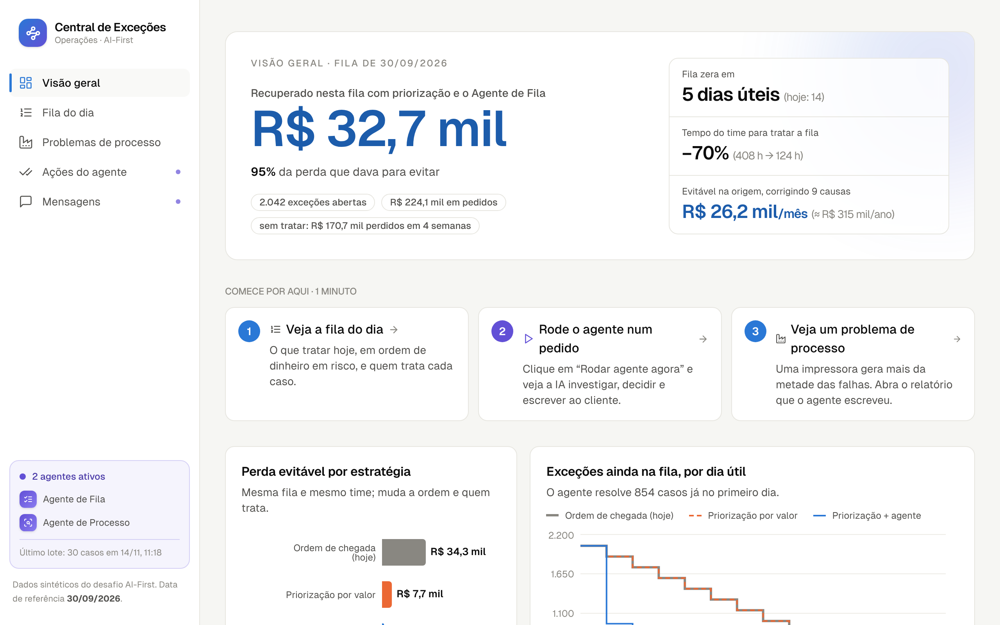
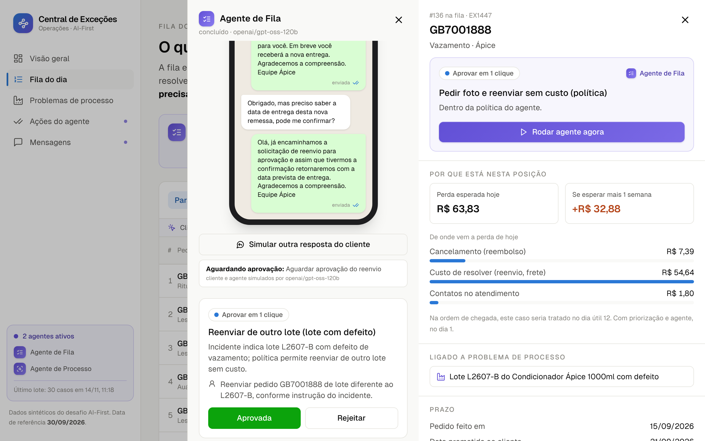
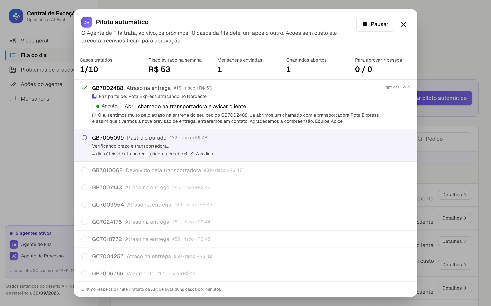
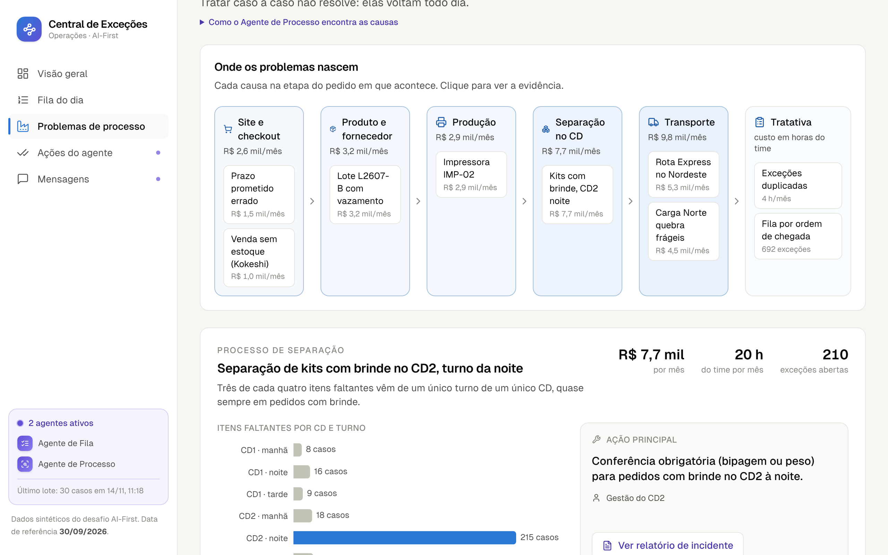

# Central de Exceções — Desafio AI-First Gogroup

**Problema 2 · Operações.** Uma central que prioriza, investiga e ajuda a resolver os pedidos com exceção, com dois agentes de IA trabalhando dentro dela.

🔗 **Solução publicada:** https://desafio-gogroup.vercel.app · **Código:** https://github.com/RianLMA-dev/desafio-gogroup

## O resultado em uma frase

> Com priorização por valor em risco e o Agente de Fila, a operação recupera **R$ 32,7 mil** desta fila (95% da perda que dava para evitar) e zera as 2.042 exceções em **5 dias úteis, não 14**, usando **70% menos tempo do time**.

| Estratégia (mesma fila, mesma capacidade de 150/dia) | Perda evitável | Fila zera em |
|---|---|---|
| Ordem de chegada (como é hoje) | R$ 34,3 mil | 14 dias úteis |
| Priorização por valor em risco | R$ 7,7 mil | 14 dias úteis |
| **Priorização + Agente de Fila** | **R$ 1,5 mil** | **5 dias úteis** |

Além disso, **9 causas na origem** geram exceções que voltam todo dia e custam **≈ R$ 26 mil por mês e 93 horas do time por mês**. O Agente de Processo encontra e documenta cada uma.



## Como avaliar em 2 minutos

1. **Abra a [solução](https://desafio-gogroup.vercel.app)** e leia o bloco de destaque da Visão geral: o resultado e de onde ele vem.
2. **Clique em "Rode o agente num pedido"** (passo 2 do "Comece por aqui") e depois em **Rodar agente agora**. O Agente de Fila investiga o pedido com ferramentas, mostra o que descobriu, decide dentro da política e escreve ao cliente. Depois de enviada, clique em **Simular resposta do cliente**.
3. **Na Fila do dia, clique em Iniciar piloto automático** e veja o agente tratar 10 casos seguidos.
4. **Em Problemas de processo**, veja o mapa de onde cada causa nasce e abra um **relatório de incidente** escrito pelo Agente de Processo.
5. **Em Ações do agente**, veja a qualidade medida em 90 casos e aprove ou rejeite reenvios.

| O agente investigando e conversando | O piloto automático |
|---|---|
|  |  |



## Como funciona

```
                 ┌──────────────────────────────┐
 dados do ERP ──▶│  Motor de cálculo (Python)   │  valor em risco de cada exceção,
                 │  analise/motor.py            │  prioridade, simulação dos cenários,
                 └──────────────┬───────────────┘  detecção estatística de padrões
                                │
          ┌─────────────────────┴─────────────────────┐
          ▼                                           ▼
┌───────────────────────┐                 ┌───────────────────────┐
│    Agente de Fila     │◀── instruções ──│  Agente de Processo   │
│  investiga cada caso  │   dos incidentes│  escreve relatórios   │
│  com ferramentas e    │                 │  de incidente para a  │
│  age (3 níveis)       │                 │  liderança            │
└───────────────────────┘                 └───────────────────────┘
```

**Motor de cálculo (código, não IA).** Para cada exceção calcula a perda esperada — cancelamento, custo de reenvio, recompra perdida, contatos no atendimento, venda não recuperada — e quanto ela cresce se o caso esperar mais uma semana. Esse crescimento ordena a fila. Números precisam ser exatos e reproduzíveis, por isso não dependem da IA.

**Agente de Fila (IA com ferramentas).** Para cada exceção, o agente decide quais ferramentas usar — `consultar_pedido`, `consultar_cliente`, `verificar_prazo`, `verificar_incidentes`, `consultar_politica` — e registra uma ação com mensagem ao cliente, chamado para a transportadora e nota para o time. Trabalha em três níveis:

| Nível | O que é | Exemplos | Casos na fila |
|---|---|---|---|
| Resolve sozinho | ações sem custo | avisar data correta, abrir chamado, lembrete de pagamento, fechar duplicado | 854 |
| Aprovação em 1 clique | ações com custo | reenvio, nova produção | 681 |
| Pessoa | fora da política | pedido > R$ 200, cliente VIP, 3+ contatos, extravio, ruptura | 507 |

**Guardrails:** a política é verificada em código. Se o agente tentar uma ação fora da política (por exemplo, resolver sozinho um pedido de cliente VIP), o sistema recusa e explica o motivo, e o agente se corrige.

**Agente de Processo (IA).** Recebe a evidência estatística de cada padrão anormal e escreve um relatório de incidente: o que acontece, causa raiz, impacto em R$, plano de ação com responsável e prazo, e como medir se resolveu. As instruções dos incidentes alimentam o Agente de Fila (ex.: "reenvie de outro lote, nunca do L2607-B").

**Demonstração.** Ao rodar o agente num pedido, cada passo mostra o que ele descobriu (cliente VIP, atraso real, problema de processo ligado — com a instrução do Agente de Processo em destaque) e a mensagem aparece sendo digitada num celular. Depois de enviada, dá para **simular a resposta do cliente**: a IA interpreta o cliente (manda a foto, pede reembolso, cobra prazo) e o agente reage dentro da política. Na Fila do dia, o **piloto automático** deixa o agente tratar ao vivo os próximos 10 casos dele, com contadores de mensagens, chamados e risco evitado. Em *Problemas de processo*, um mapa mostra em que etapa do caminho do pedido cada causa nasce.

**Lote + ao vivo.** Como em produção, os agentes processam a fila em lote (`npm run agente:lote`) e o resultado aparece nas telas *Ações do agente* e *Mensagens*. Em qualquer pedido ou incidente, o botão **Rodar agente agora** executa o agente ao vivo. As ações são simuladas: em produção seriam integrações com WhatsApp, transportadoras e ERP.

## Causas-raiz encontradas

| Causa | Tipo | Custo/mês |
|---|---|---|
| Separação de kits com brinde no CD2, turno da noite | Processo | R$ 7,7 mil |
| Rota Express atrasando no Nordeste (piorou desde 31/08) | Transportadora | R$ 5,3 mil |
| Carga Norte danificando produtos frágeis | Transportadora | R$ 4,5 mil |
| Lote L2607-B do Condicionador Ápice 1000ml com defeito | Fornecedor | R$ 3,2 mil |
| Impressora IMP-02 com defeito (desde 24/08) | Produção | R$ 2,9 mil |
| Prazo prometido calculado em dias corridos (30% dos "atrasos" não são atrasos) | Sistema | R$ 1,5 mil + 15 h/mês |
| Site vendendo produtos Kokeshi sem estoque | Estoque | R$ 1,0 mil |
| Exceções registradas em duplicidade | Sistema | 4 h/mês |
| Fila envelhecida e pagamentos esquecidos | Gestão | — |

Critério: concentração muito acima do normal, estatisticamente significativa (com correção para comparações múltiplas), com mecanismo operacional plausível e acionável. Endereço divergente, devolução, pagamento pendente e extravio **não** têm causa na origem — os sinais que apareceram eram efeito de composição ou acaso — e são tratados caso a caso.

## A conclusão se mantém?

Rodamos o modelo inteiro de novo (`analise/robustez.py`) variando, uma de cada vez, as premissas mais incertas — tolerância do cliente à espera, tabela de cancelamento ±50%, valor da recompra ×0,5 e ×2, sem contatos, aprovação mais lenta, capacidade menor — e todas juntas no pior sentido.

| Cenário | Recuperado com o agente | % do evitável | Fila zera |
|---|---|---|---|
| Premissas do modelo | R$ 32,7 mil | 95% | 5 dias (vs. 14) |
| Pior variação isolada (cancelamentos −50%) | R$ 24,3 mil | 94% | 5 dias (vs. 14) |
| **Tudo junto, no pior sentido** | **R$ 20,2 mil** | **91%** | **6 dias (vs. 14)** |

O valor em reais muda com as premissas; a conclusão — priorizar e automatizar recupera mais de 90% do evitável e zera a fila em menos da metade do tempo — não muda.

## Qualidade do agente

Os números usam a política do agente para dizer quem trata cada caso. Para conferir, comparamos com o que a IA decide investigando sozinha, em 90 casos do lote (30 de cada nível), todos revisados um a um.

- **Primeira rodada: 89% (80 de 90)** no mesmo nível que a política. Todas as 10 divergências eram devoluções em que a IA abria chamado na transportadora — mas o pedido devolvido já voltou ao CD, então a ação não fazia sentido. O erro estava na política, que permitia essa ação; corrigimos a política.
- **Depois da correção: 100% (90 de 90)**, com 5 casos em que a checagem em código barrou uma ação da IA e ela se corrigiu.
- Erros encontrados na revisão viraram regras verificadas em código: endereço inventado, previsão com data passada, ação errada para atraso real e detalhe interno (impressora, lote) na mensagem ao cliente.

## Premissas

As regras que não estão nos parâmetros do negócio estão listadas no app (Visão geral → Premissas) e em `analise/motor.py`. As principais: o cliente cancela com base na data que foi prometida a ele; quando a exceção é tratada o risco para de crescer; uma exceção vira "mal resolvida" gradualmente entre 2 e 10 dias úteis de espera; o limite do agente é R$ 200 (≈ 2× o ticket médio — testamos de R$ 100 a sem limite e acima disso o ganho é mínimo).

## Estrutura

```
analise/   Motor de cálculo e análises em Python (pandas, numpy, scipy)
dados/     Dados do desafio (sintéticos)
docs/      Capturas de tela usadas neste README
app/       Site Next.js 15 + Tailwind + Recharts, agentes via API do Groq
```

## Rodar localmente

```bash
# 1. (opcional) regenerar os números do motor
pip install pandas numpy scipy
python analise/exportar.py

# 2. site
cd app
npm install
echo GROQ_API_KEY=sua-chave > .env.local    # chave grátis em console.groq.com
npm run dev                                  # http://localhost:3000

# 3. (opcional) reprocessar o lote dos agentes, com o site rodando
npm run agente:lote -- --por-nivel 10
```

Sem chave, os agentes rodam em **modo simulado** (mesma investigação e política, mensagens de modelo). Se o limite gratuito do Groq for atingido, o app tenta outros modelos e, em último caso, mostra a decisão pela política com um aviso.

## Ferramentas

Construído com **Claude Code** (análise, motor, app e agentes). IA dos agentes: modelos abertos via **Groq** (`openai/gpt-oss-120b`, `qwen/qwen3.8-27b`, `openai/gpt-oss-20b`).
